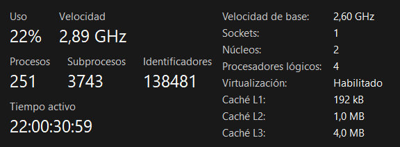

# Recursos del equipo: notebooks y máquinas virtuales

**Consultora:** BrainStorming  
**Sprint:** 1  
**Fecha:** 09/10/2026  
**Tarea del backlog:** Definir recursos del equipo (notebooks de integrantes, máquinas virtuales)

<!-- Cómo completar este archivo:
1. Reemplazá cada [COMPLETAR] con el dato real de tu notebook.
2. Guardá las capturas en esta misma carpeta, con el nombre indicado debajo de cada integrante.
3. Si alguien no aporta máquina, dejá la fila y poné "No" en la última columna.
4. Borrá este comentario cuando termines. -->

## 1. Decisión
Se usa la **Vía A**: Windows 11 y Ubuntu se instalan en máquinas virtuales con **VirtualBox**
dentro de las notebooks de los integrantes.

Integrantes que aportan máquina: [COMPLETAR nombres].

## 2. Notebooks del equipo
Los datos se obtienen en PowerShell:

```powershell
Get-CimInstance Win32_ComputerSystem | Select Manufacturer, Model, @{n="RAM_GB";e={[math]::Round($_.TotalPhysicalMemory/1GB)}}
Get-PSDrive C | Select @{n="Libre_GB";e={[math]::Round($_.Free/1GB)}}
```

La virtualización se ve en el Administrador de tareas, pestaña Rendimiento, CPU.

| N.º | Integrante | Modelo | Sistema actual | RAM (GB) | Disco libre (GB) | Virtualización habilitada | Aporta máquina |
|---|---|---|---|---|---|---|---|
| 1 | Alanis Nicolás | [COMPLETAR] | [COMPLETAR] | [COMPLETAR] | [COMPLETAR] | [Sí / No] | [Sí / No] |
| 2 | Arroyo Andrea | Aspire A515-43 | Windows 11 Home Single Language | 6 GB | 19 GB | Sí | No |
| 3 | Mansilla David | [COMPLETAR] | [COMPLETAR] | [COMPLETAR] | [COMPLETAR] | [Sí / No] | [Sí / No] |
| 4 | Marun Susana | [COMPLETAR] | [COMPLETAR] | [COMPLETAR] | [COMPLETAR] | [Sí / No] | [Sí / No] |
| 5 | Miwszuk Hazahel | [COMPLETAR] | [COMPLETAR] | [COMPLETAR] | [COMPLETAR] | [Sí / No] | [Sí / No] |
| 6 | Lopez Salomon Federico | [COMPLETAR] | [COMPLETAR] | [COMPLETAR] | [COMPLETAR] | [Sí / No] | [Sí / No] |
| 7 | Perez Cristian | [COMPLETAR] | [COMPLETAR] | [COMPLETAR] | [COMPLETAR] | [Sí / No] | [Sí / No] |
| 8 | Veliz Julieta | [COMPLETAR] | [COMPLETAR] | [COMPLETAR] | [COMPLETAR] | [Sí / No] | [Sí / No] |

**Requisito mínimo acordado:** 8 GB de RAM y 40 GB libres.  
**Cumplen el requisito:** 2 de 8.

## 3. Asignación de máquinas virtuales
Las dos máquinas se configuran con la misma cantidad de memoria, procesadores y disco, para que la comparación sea justa.

| Máquina virtual | Sistema | Notebook donde corre (integrante) | RAM asignada (GB) | Procesadores | Disco (GB) |
|---|---|---|---|---|---|
| VM-1 | Windows 11 | [COMPLETAR] | [COMPLETAR] | [COMPLETAR] | [COMPLETAR] |
| VM-2 | Ubuntu | [COMPLETAR] | [COMPLETAR] | [COMPLETAR] | [COMPLETAR] |

## 4. Capturas de virtualización habilitada
Una captura por notebook: Administrador de tareas, Rendimiento, CPU, donde diga "Virtualización: Habilitado".

### Integrante 1: [COMPLETAR apellido]


### Integrante 2: Arroyo


### Integrante 3: [COMPLETAR apellido]


### Integrante 4: [COMPLETAR apellido]


### Integrante 5: [COMPLETAR apellido]


### Integrante 6: [COMPLETAR apellido]


### Integrante 7: [COMPLETAR apellido]


### Integrante 8: [COMPLETAR apellido]


## 5. Observaciones
Equipo de Arroyo Andrea, no cumple con los requisitos mínimos acordados de RAM y GB libres
