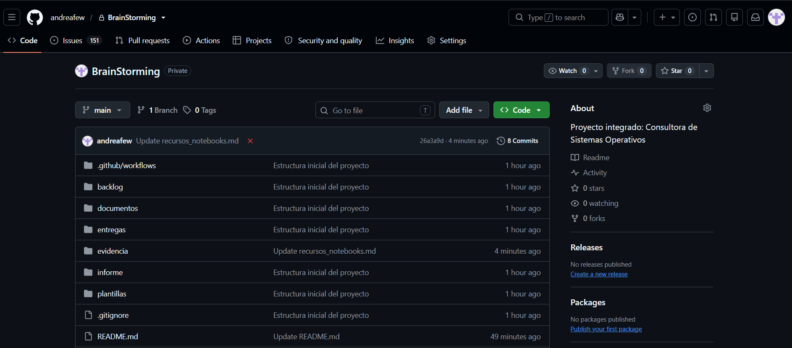
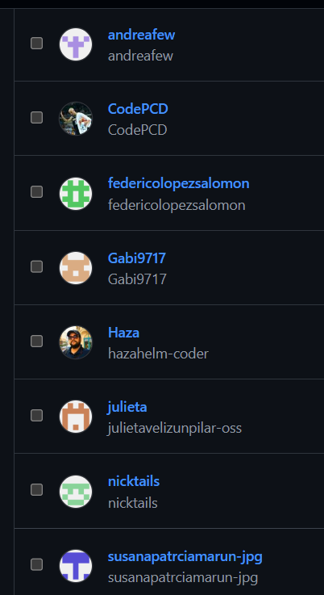
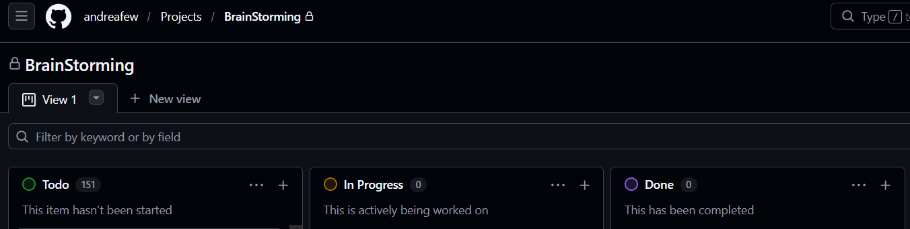
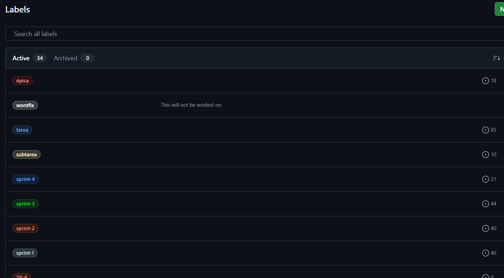
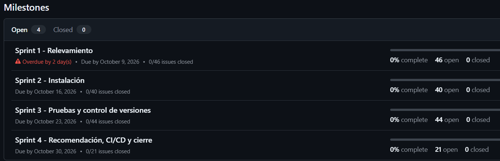

# Repositorio de GitHub y tablero (Project)

**Consultora:** BrainStorming  
**Sprint:** 1  
**Fecha:** 10/10/2026  
**Tarea del backlog:** Crear repositorio GitHub y Project (tablero)

## 1. Repositorio
| Dato | Valor |
|---|---|
| Nombre del repositorio | BrainStorming |
| Dirección (URL) | https://github.com/andreafew/BrainStorming |
| Visibilidad | Privado |
| Propietario | andreafew |

### Captura 1: página principal del repositorio

## 2. Equipo con acceso
Se invitó como colaboradores a los 7 integrantes restantes (Settings, Collaborators).

| Persona | Usuario de GitHub | Rol | Invitación aceptada |
|---|---|---|---|
| Alanis Nicolás | nicktails | Scrum Master | Sí |
| Lopez Salomon Federico | federicolopezsalomon | Developer | Sí |
| Mancilla David | Gabi9717 | Developer | Sí |
| Marun Susana | susanapatrciamarun-jpg | Developer | No |
| Miwszuk Hazahel | hazahelm-coder | Developer | Sí |
| Perez Cristian | CodePCD | Product Owner | Sí |
| Veliz Julieta | julietavelizunpilar-oss | Developer | Sí |

### Captura 2: lista de colaboradores

## 3. Project (tablero)
| Dato | Valor |
|---|---|
| Nombre del Project | BrainStorming |
| Plantilla | Board |
| Columnas | To Do, In Progress, Done |
| Límite de trabajo en curso (WIP) | 4 |

### Captura 3: tablero con sus tres columnas

## 4. Etiquetas (labels) e hitos (milestones)
Etiquetas principales: tipo de elemento (épica, historia, tarea, prueba, documento), cliente, sprint, puntos (SP) y prioridad.
Hitos: Sprint 1 al Sprint 4, con su fecha límite.

### Captura 4: lista de etiquetas

### Captura 5: hitos de los cuatro sprints

## 5. Observaciones
Comenzamos con un repositorio de GitHub cuando se lanzó el proyecto, pero con el correr del tiempo y preguntas a la IA, descubrimos que se podían utilizar más herramientas y que todo nuestro trabajo podría verse más prolijo y completo, por lo que después de la última clase (09/10/2026) decidimos migrar lo que ya habíamos realizado a este nuevo repositorio y agregarle más detalle, razón por la cual, distintas actividades pueden verse como Overdue.
