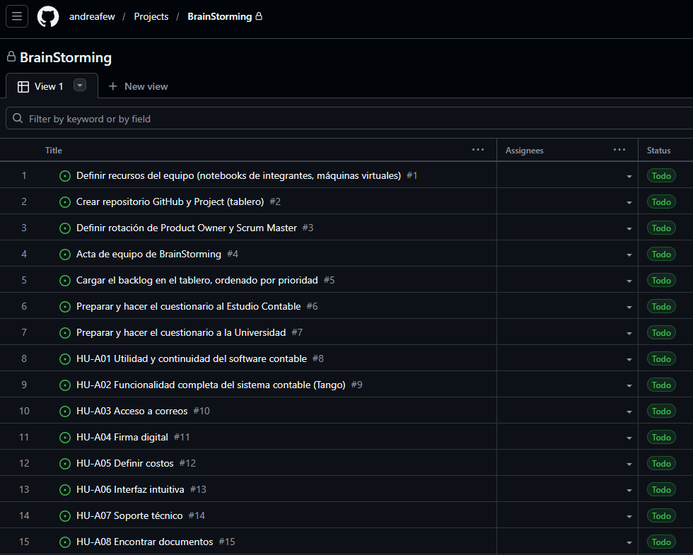
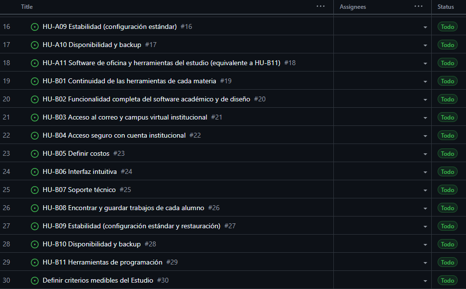
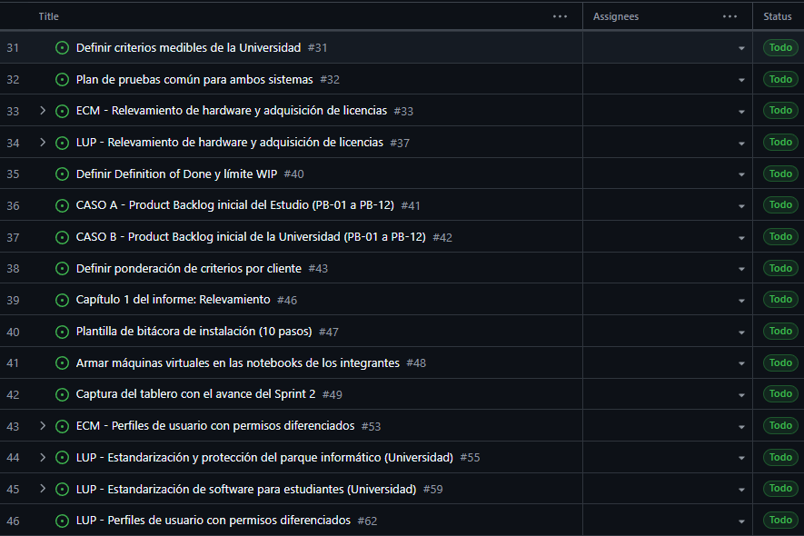

# 5 · Cargar el backlog en el tablero, ordenado por prioridad

**Cliente:** Equipo · **Sprint:** 1 · 

## Qué se pidió
Como Product Owner, necesito que todo el trabajo del Sprint 1 esté cargado en el tablero y ordenado por prioridad, para que el equipo sepa qué hacer primero.

**Criterio de aceptación:** Todas las historias y tareas del Sprint 1 cargadas en el Project, ordenadas por prioridad; captura del tablero.

## Qué se hizo
Todas las historias y tareas del Sprint 1 fueron cargadas en el Project, ordenadas por prioridad.

## Historias y tareas a cargar en el Project
| Origen | Título | Tipo |
|---|---|---|
| Modificado | Definir recursos del equipo (notebooks de integrantes, máquinas virtuales) | Tarea |
| Agregado | Crear repositorio GitHub y Project (tablero) | Tarea |
| Agregado | Definir rotación de Product Owner y Scrum Master | Tarea |
| Agregado | Acta de equipo de BrainStorming | Tarea |
| Agregado | Cargar el backlog en el tablero, ordenado por prioridad | Tarea |
| Agregado | Preparar y hacer el cuestionario al Estudio Contable | Tarea |
| Agregado | Preparar y hacer el cuestionario a la Universidad | Tarea |
| Existente | HU-A01 Utilidad y continuidad del software contable | Historia |
| Existente | HU-A02 Funcionalidad completa del sistema contable (Tango) | Historia |
| Existente | HU-A03 Acceso a correos | Historia |
| Existente | HU-A04 Firma digital | Historia |
| Existente | HU-A05 Definir costos | Historia |
| Existente | HU-A06 Interfaz intuitiva | Historia |
| Existente | HU-A07 Soporte técnico | Historia |
| Existente | HU-A08 Encontrar documentos | Historia |
| Existente | HU-A09 Estabilidad (configuración estándar) | Historia |
| Existente | HU-A10 Disponibilidad y backup | Historia |
| Agregado | HU-A11 Software de oficina y herramientas del estudio (equivalente a HU-B11) | Historia |
| Agregado | HU-B01 Continuidad de las herramientas de cada materia | Historia |
| Agregado | HU-B02 Funcionalidad completa del software académico y de diseño | Historia |
| Agregado | HU-B03 Acceso al correo y campus virtual institucional | Historia |
| Agregado | HU-B04 Acceso seguro con cuenta institucional | Historia |
| Agregado | HU-B05 Definir costos | Historia |
| Agregado | HU-B06 Interfaz intuitiva | Historia |
| Agregado | HU-B07 Soporte técnico | Historia |
| Agregado | HU-B08 Encontrar y guardar trabajos de cada alumno | Historia |
| Agregado | HU-B09 Estabilidad (configuración estándar y restauración) | Historia |
| Agregado | HU-B10 Disponibilidad y backup | Historia |
| Existente | HU-B11 Herramientas de programación | Historia |
| Agregado | Definir criterios medibles del Estudio | Tarea |
| Agregado | Definir criterios medibles de la Universidad | Tarea |
| Agregado | Plan de pruebas común para ambos sistemas | Tarea |
| Existente | ECM - Relevamiento de hardware y adquisición de licencias | Épica |
| Existente | Relevar los 30 equipos del Estudio | Tarea |
| Modificado | Cotizar licencias nuevas para el Estudio (30 equipos) | Tarea |
| Modificado | Cotizar 20 notebooks para el Estudio (con y sin licencia) | Tarea |
| Agregado | LUP - Relevamiento de hardware y adquisición de licencias | Épica |
| Agregado | Relevar los 25 equipos del laboratorio | Tarea |
| Agregado | Cotizar licencias para la Universidad (Windows 11 educativo/Pro; Ubuntu sin costo de licencia) | Tarea |
| Agregado | Definir Definition of Done y límite WIP | Tarea |
| Existente | CASO A - Product Backlog inicial del Estudio (PB-01 a PB-12) | Documento |
| Agregado | CASO B - Product Backlog inicial de la Universidad (PB-01 a PB-12) | Documento |
| Agregado | Definir ponderación de criterios por cliente | Tarea |
| Agregado | Reinstalar Windows 11 en los 7 equipos del Estudio que tenían Windows 10 | Tarea |
| Agregado | Cotizar reposición o ampliación de equipos de la Universidad (si el relevamiento lo exige) | Tarea |
| Agregado | Capítulo 1 del informe: Relevamiento | Tarea |

## Capturas de project cargado

## Observaciones
La columna Origen se refiere a la unificación de datos antes de la migración al nuevo repositorio.
